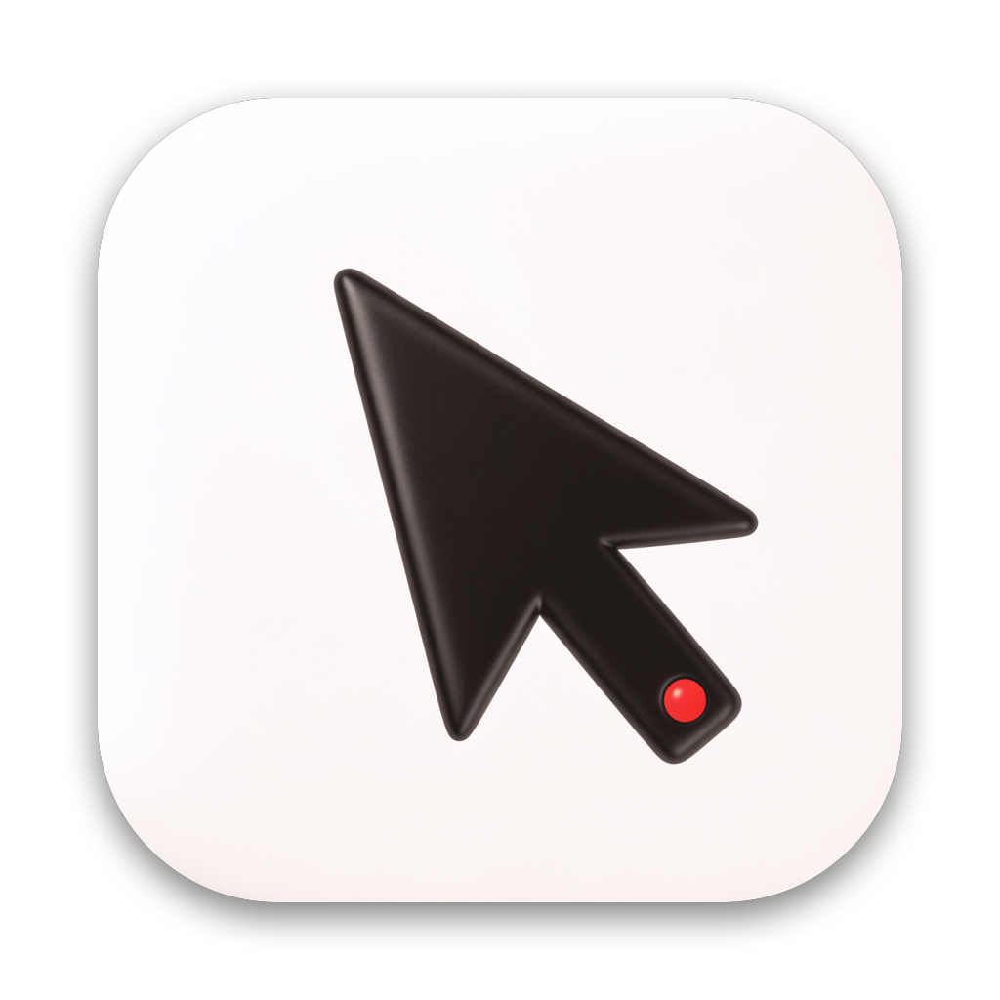
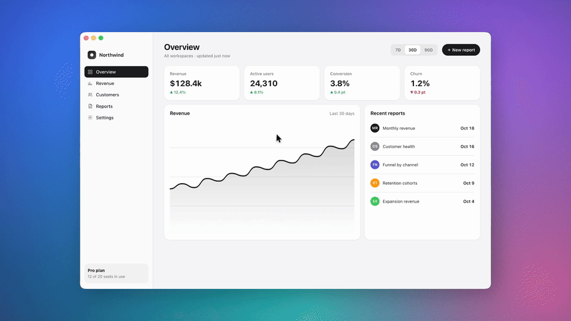
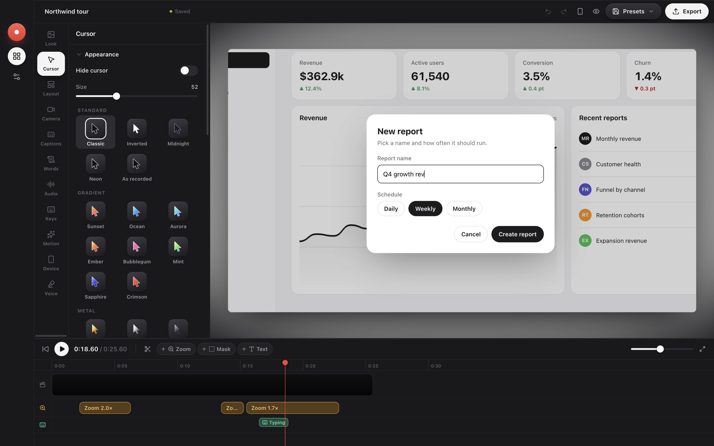
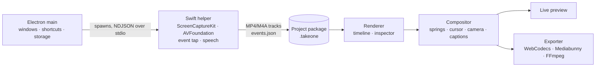

<p align="center">
  
</p>

<h1 align="center">Take One</h1>

<p align="center">
  <strong>Screen recordings that look edited, on the first take.</strong><br>
  An open-source screen recorder for macOS that zooms in where you click, smooths your cursor,<br>
  and frames everything on a beautiful background. Free, private, and built in the open.
</p>

<p align="center">
  <a href="https://github.com/Rupam-Shil/TakeOne/actions/workflows/ci.yml"></a>
  <a href="LICENSE"></a>
  
  
  <a href="CONTRIBUTING.md"></a>
</p>

<p align="center">
  <a href="#install">Install</a> ·
  <a href="#features">Features</a> ·
  <a href="#build-from-source">Build from source</a> ·
  <a href="#how-it-works">How it works</a> ·
  <a href="CONTRIBUTING.md">Contributing</a>
</p>

<p align="center">
  
</p>

<p align="center"><sub>Recorded and edited entirely in Take One: the zooms, cursor and background were added automatically. <a href="website/assets/northwind-tour.mp4">Watch the full 25-second clip</a>.</sub></p>

---

## Why Take One

Raw screen recordings are hard to watch. The interesting part is a tiny button in a huge screen, the cursor jitters, and the video floats on nothing. Fixing that by hand in a video editor takes longer than the recording itself.

Take One records your screen together with every click, keystroke and cursor movement, then uses them to edit the video for you. You get a polished demo the moment you stop recording, and every decision stays editable on a timeline.

- **No account, no watermark, no paid tier.** It's MIT licensed.
- **Private by default.** Recording, editing, transcription and AI voices run on your Mac. Nothing is uploaded unless you set up your own share server.
- **Native capture.** A small Swift helper uses ScreenCaptureKit and AVFoundation, so recordings are sharp and in sync.

## Install

Take One is in early development and there's no notarised release yet.

1. Download the latest `.dmg` from [Releases](https://github.com/Rupam-Shil/TakeOne/releases/latest) when one is published, or [build it yourself](#build-from-source).
2. Drag **Take One** to Applications.
3. The first time, right-click the app and choose **Open**, because the build isn't notarised.
4. Follow the welcome screen to grant Screen Recording (required), plus Accessibility, Input Monitoring, Camera and Microphone if you want click-aware zooms, keystroke overlays and a webcam.

Requires macOS 15 or later on Apple Silicon. On-device transcription with Apple's speech engine needs macOS 26; Whisper transcription works on macOS 15.

## Features

### Record
- **Display, window or area**, plus an iPhone or iPad connected over USB.
- **Camera, microphone and system audio** on separate, synced tracks. Record audio from every app or just the ones you pick.
- **Countdown, pause, restart and discard**, timeline markers, and speaker notes that never show up in the recording.
- **Window size presets**, hidden desktop icons, a dimmed area outside what you record, and auto-stop when the disk runs low.
- **Crash-safe files**: an interrupted recording is recovered the next time you open the app.

### Edit automatically
- **Auto zoom** follows your clicks with smooth spring animation. Add, move, resize or delete zooms on the timeline, or use the glass loupe.
- **Smooth cursor**: the real pointer is hidden during capture and re-rendered at any size, with spring smoothing, tilt, click effects and 27 styles, including gradient, metal, minimal and pixel sets.
- **Backgrounds**: wallpapers, gradients, solid colours, images and blur, with padding, rounded corners, shadows and an inset border.
- **Camera layouts**: overlay, split screen, camera only, screen only, and cutouts shaped as circles, rounded squares, squares or hexagons. Includes face tracking, background blur or removal, and colour looks.

### Fine-tune
- **Timeline**: trim, split, ripple delete, speed from 0.5× to 24×, per-clip volume, and suggestions to speed up long stretches of typing.
- **Masks** that blur, pixelate or highlight, and can follow scrolling content. Also text overlays and keyboard shortcut overlays.
- **Captions and edit-by-transcript**: delete words to cut the video, remove filler words, tighten pauses, and export SRT or VTT.
- **Audio**: microphone clean-up presets, background music with fades, and voiceovers you record or generate on-device.
- **Presets**, undo and redo, autosave, and a project library.

### Export
- **MP4** in H.264, HEVC or AV1 from 720p to 4K at up to 60 fps, **GIF**, copy to the clipboard, or save the current frame as an image.
- **Shareable links** through a tiny server you host yourself.

<p align="center">
  
</p>

## Keyboard shortcuts

| Action | Shortcut |
|---|---|
| Start or stop recording | ⌃⌘↩ |
| Record display / window / area | ⌥⌘3 / ⌥⌘4 / ⌥⌘5 |
| Pause or resume | ⌥⌘P |
| Restart recording | ⌥⌘⌫ |
| Drop a marker | ⌃⌥⌘F |
| Speaker notes | ⌥⌘. |
| Command menu (editor) | ⌘K |
| All editor shortcuts | ⌘/ |
| Export | ⇧⌘E |
| Preview mode | ⇧⌘↩ |

Recording shortcuts can be changed in Settings → Shortcuts.

## On-device AI

Two optional models run entirely on your Mac. They download the first time you use them and never leave it.

- **Natural voices (Kokoro, about 90 MB)**: type a line and add it at the playhead, or re-voice a whole narration from its transcript, in sync with the video.
- **Whisper transcription (150 MB or 480 MB)**: for Macs without the macOS 26 speech engine, or when you prefer it.

Settings → General shows how much model data is stored and lets you delete it.

## Shareable links

Links go to a small, dependency-free Node server that you run:

```bash
SHARE_TOKEN=$(openssl rand -hex 24) PUBLIC_URL=https://share.example.com node share-server/server.mjs
```

Add its address and token in Settings → Sharing. Links can be public or private, the watch page streams with range requests, and `/dashboard` lists your videos with view counts.

## Build from source

You need macOS 15 or later on Apple Silicon, **Xcode 26** (or its Command Line Tools, for the macOS 26 SDK and Swift 6.2+), and **Node.js 22** or later.

```bash
git clone https://github.com/Rupam-Shil/TakeOne.git
cd TakeOne
npm install
npm run dev     # builds the Swift helper, then starts the app with hot reload
```

| Command | What it does |
|---|---|
| `npm run dev` | Builds the capture helper and runs the app with hot reload |
| `npm run build:native` | Rebuilds only the Swift capture helper |
| `npm run typecheck` | Type-checks the whole project |
| `npm test` | Runs the unit tests (Vitest) |
| `npm run dist` | Packages `dist/Take One-<version>-arm64.dmg` |

The helper is ad-hoc signed, so macOS may ask for its permissions again after you rebuild it. See [CONTRIBUTING.md](CONTRIBUTING.md) for the full development guide.

## How it works



- **`native/recorder`**: a Swift command-line helper. It records each source to its own file on one shared clock and logs pointer, click, key and cursor-shape events.
- **`src/main`**: the Electron main process, covering the window, tray, global shortcuts, recorder process, project storage and presets.
- **`src/renderer/src/render`**: the compositor shared by preview and export, so what you see is exactly what you export.
- **`src/renderer/src/editor`**: the editor UI, with preview, timeline, inspector panels and undo history.
- **`src/renderer/src/export`**: frame-accurate decoding of variable-frame-rate recordings, offline audio mixing and encoding.
- **`share-server`**: the optional self-hosted link server.

A project is a folder named `<name>.takeone` containing `project.json` and a `recording/` folder with the screen, camera, microphone and system-audio tracks, plus `meta.json` and `events.json`. Older `.studioclone` projects open too.

## Roadmap

- Notarised, signed releases with automatic updates
- Intel Mac support
- More export targets and presets
- Windows and Linux are not planned yet, since capture is built on macOS APIs

Have an idea? [Open a feature request](https://github.com/Rupam-Shil/TakeOne/issues/new/choose).

## Contributing

Bug reports, ideas and pull requests are all welcome. Start with [CONTRIBUTING.md](CONTRIBUTING.md), and please follow the [Code of Conduct](CODE_OF_CONDUCT.md). Report security issues privately as described in [SECURITY.md](SECURITY.md).

## Acknowledgements

Take One stands on [Electron](https://www.electronjs.org), [React](https://react.dev), [Tailwind CSS](https://tailwindcss.com), [Mediabunny](https://mediabunny.dev), [MediaPipe](https://ai.google.dev/edge/mediapipe), [Transformers.js](https://huggingface.co/docs/transformers.js), [Kokoro](https://huggingface.co/hexgrad/Kokoro-82M), [Lucide](https://lucide.dev) and [FFmpeg](https://ffmpeg.org).

<details>
<summary>Third-party licences</summary>

Take One's own code is MIT licensed. It ships or downloads these components under their own licences:

- Electron, React, Tailwind CSS, zustand, immer and ONNX Runtime Web: MIT. Lucide icons: ISC.
- MediaPipe Tasks Vision: Apache-2.0, used for face tracking and camera background removal.
- Transformers.js and Kokoro: Apache-2.0. The Kokoro and Whisper model weights are downloaded at runtime under their own licences.
- Mediabunny: MPL-2.0, used for MP4 muxing and decoding.
- FFmpeg via `ffmpeg-static`: a GPL-3.0-or-later build, used for GIF export. It runs as a separate program, and packaged builds include its binary and licence.

</details>

## License

[MIT](LICENSE) © 2026 Rupam Shil

<sub>Take One is an independent project and is not affiliated with Screen Studio or its makers.</sub>
